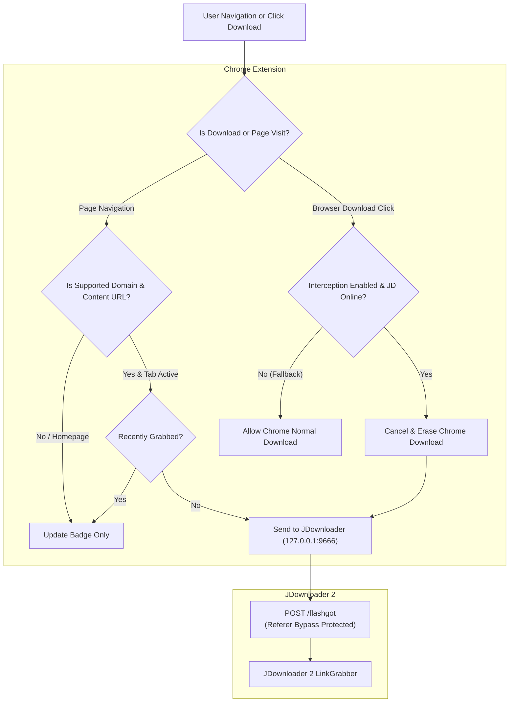

# JDownloader 2 LinkGrabber Autodetect

[](https://developer.chrome.com/docs/extensions/mv3/)
[](https://jdownloader.org/)
[](#-comprehensive-database-8613-domains)
[](LICENSE)
[](README_VI.md)

An intelligent Google Chrome extension (Manifest V3) that automatically detects file-hosters and decrypters supported by JDownloader 2, intercepts native browser downloads to prevent annoying "Save As" dialogs, and seamlessly streams download links straight into JDownloader 2's **LinkGrabber**.

---

## 🌟 Key Features

### 1. 🌐 Comprehensive Database (8,613+ Domains)
- Built directly from JDownloader 2's internal engine controllers (`HostPluginController` & `CrawlerPluginController`) and physical plugin libraries (`jd/plugins/hoster` & `jd/plugins/decrypter`).
- Covers all major file hosting services: **Mega.nz, Fshare.vn, Rapidgator, Mediafire, 1fichier, Google Drive, YouTube, Filecrypt, Adf.ly, Ouo.io, Dropgalaxy, Ddownload, Pixeldrain**, and over 8,600 other domains.

### 2. ⚡ Smart Auto-Grab with Anti-Spam Protection
- **Automatic Link Detection:** Automatically detects supported URLs when navigating and pushes them to JDownloader 2 LinkGrabber via the local FlashGot loopback API (`http://127.0.0.1:9666/flashgot`).
- **Startup Protection & Session Restore Shield:** When you boot up your computer and Chrome restores tabs from your previous session, the extension activates a 15-second safety buffer and snapshots existing tabs. It **never spams link grabs or notifications on startup**.
- **Active Tab Only:** Background tabs loaded silently or restored in the background are strictly ignored.
- **Content-Only URL Filter:** Automatically skips generic homepages, newsfeeds, and dashboards (`youtube.com/`, `facebook.com/`, `drive.google.com/drive/my-drive`, `mega.nz/`, etc.). Only actual downloadable files, videos (`watch?v=`), folders, and shortlinks are captured.
- **Persistent History:** Retains grabbed URLs in `chrome.storage.local` across browser restarts and system reboots for 12 hours to prevent duplicate grabs.
- **Notification Debouncing:** Consolidates rapid captures into a single toast notification that auto-clears after 4 seconds.

### 3. 🛑 Native Download Interception & "Save As" Dialog Suppression
- Whenever you initiate a file download in Chrome (clicking download buttons, direct file links, attachments), the extension hooks into `chrome.downloads.onDeterminingFilename`.
- **Suppresses "Save As" Dialog:** Cancels the native Chrome download pipeline and clears it from the download shelf (`chrome.downloads.erase`) before the operating system file picker appears.
- **Transfers to JDownloader 2:** Routes the direct download URL, filename, and original referer directly into JDownloader 2.
- **Smart Fallback:** If JDownloader 2 is closed or offline, Chrome automatically falls back to downloading the file normally so your work is never interrupted.

### 4. ➕ 1-Click Custom Domain Addition
- **Right-Click Context Menu:** Right-click anywhere on any page and choose *"➕ Add this domain to JDownloader Database"* to save it and grab the current page immediately.
- **Extension Popup Menu:** If a site is not yet in the database, a prominent *"➕ Add this site to Database"* button appears in the popup.
- Added domains are stored permanently in extension storage and recognized on all future visits.

### 5. 📊 Modern Popup & Database Management Dashboard
- **Popup UI:** Displays real-time JDownloader 2 connection status, plugin classification, quick toggles (Auto-Grab, Download Interception, Notifications), and manual grab buttons.
- **Options / Database Explorer (`options/options.html`):** Fast search across 8,600+ domains, custom domain management (add/delete), package naming templates, and port configuration.

---

## 🏗️ Architecture & Data Flow



---

## 📋 Prerequisites

1. **JDownloader 2** installed and running on your computer.
2. The local FlashGot / Click'n'Load integration active on port `9666` (default setting in JDownloader 2).
3. Google Chrome, Brave, Microsoft Edge, Opera, or any Chromium-based browser.

---

## 🚀 Installation Guide

1. Clone or download this repository to your computer:
   ```bash
   git clone https://github.com/your-username/jdownloader-link-grabber-extension.git
   ```
2. Open your Chromium-based browser and navigate to the extensions page:
   ```text
   chrome://extensions/
   ```
3. In the top-right corner, toggle on **"Developer mode"**.
4. In the top-left corner, click **"Load unpacked"**.
5. Select the project directory:
   ```text
   .../jdownloader-link-grabber-extension
   ```
6. The extension **JDownloader 2 LinkGrabber Autodetect** is now installed! Pin it to your browser toolbar for easy access.

---

## ⚙️ Configuration & Options

Click the extension icon and select **"Open Options Page (Quản lý Database ⚙️)"** or right-click the extension icon and select **"Options"**:

| Setting | Default | Description |
| :--- | :--- | :--- |
| **JDownloader 2 Port** | `9666` | Local loopback port used by JDownloader FlashGot API. |
| **Package Name Template** | `WebGrab_{domain}` | Template for naming packages in LinkGrabber (`{domain}`, `{date}`). |
| **Auto-Grab** | `Enabled` | Automatically push supported links to LinkGrabber when visited. |
| **Download Interception** | `Enabled` | Intercept browser file downloads and route to JDownloader 2. |
| **Offline Fallback** | `Enabled` | Allow Chrome to download files normally if JDownloader 2 is not running. |
| **Notifications** | `Enabled` | Display consolidated desktop notifications when links are grabbed. |

---

## 🛠️ Database Regeneration Tool

If JDownloader 2 releases updates with new plugins, you can rescan the plugin folder and update `database.json`:

```powershell
python scripts/extract_plugins.py
```

The script inspects `JDownloader.jar` plugin controllers and parses all `.class` files in `jd/plugins/hoster` and `jd/plugins/decrypter`, regenerating a deduplicated `database.json`. Afterwards, simply click **Reload (🔄)** on the extension card in `chrome://extensions/`.

---

## 📁 Project Structure

```text
jdownloader-link-grabber-extension/
├── manifest.json              # Chrome Extension Manifest V3 definition
├── background.js              # Service worker (tab tracking, interception, FlashGot API)
├── content.js                 # Content script for toast feedback notifications
├── database.json              # 8,613+ supported domains and plugin metadata
├── icons/                     # Extension icons (16px, 32px, 48px, 128px)
├── popup/                     # Toolbar popup UI (status, quick actions, settings toggles)
│   ├── popup.html
│   ├── popup.css
│   └── popup.js
├── options/                   # Comprehensive Database Manager & Settings page
│   ├── options.html
│   ├── options.css
│   └── options.js
├── scripts/                   # Python extraction and icon generation utilities
│   ├── extract_plugins.py
│   └── generate_icons.py
├── LICENSE                    # MIT License
├── README.md                  # English Documentation (this file)
└── README_VI.md               # Vietnamese Documentation
```

---

## ❓ Troubleshooting

<details>
<summary><strong>1. Chrome still shows the "Save As" file dialog when downloading</strong></summary>

Chrome has a built-in browser setting that prompts for file destinations:
1. Open `chrome://settings/downloads`.
2. Turn **OFF** the toggle labeled **"Ask where to save each file before downloading"**.
3. Reload the extension in `chrome://extensions/`.
</details>

<details>
<summary><strong>2. JDownloader 2 shows "Offline" in popup</strong></summary>

1. Ensure JDownloader 2 is running.
2. In JDownloader 2, verify that the FlashGot / Remote API is active on port `9666`.
3. Check `cfg/org.jdownloader.api.RemoteAPIConfig.json` in your JDownloader installation and ensure `127.0.0.1` and `localhost` are allowed.
</details>

<details>
<summary><strong>3. How to add a site that is not automatically recognized?</strong></summary>

Right-click anywhere on the webpage and select **"➕ Add this domain to JDownloader Database"**, or click the extension popup and click **"➕ Add this site to Database"**.
</details>

---

## 📄 License

This project is licensed under the [MIT License](LICENSE).
